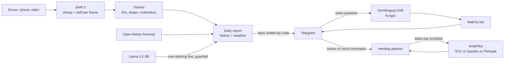

# Malchy — an AI shepherd's assistant

**Malchy** (Kyrgyz *малчы*, "herder") watches a flock from a drone or a phone,
counts every animal, notices strays, possibly sick animals, wolves and
incoming snow, tells the shepherd in Telegram — in Kyrgyz, by voice — and can
send the drone to bring a stray back to the herd.

Built solo for the **Meta Global AI Developer Hackathon** (Oct 26 – Nov 4, 2026),
theme *Build for Your World*, Indie track.

> 🎬 **Demo video:** [Watch on YouTube](https://youtu.be/WbnDDEJQx00) · 🐦

---

## The problem

Kyrgyzstan has about **6.3 million sheep and goats, 1.9 million cattle and
566,000 horses** (National Statistical Committee, 2025). On the summer
pastures (*jailoo*) they are still counted by eye. One shepherd watches
hundreds of animals; a stray or a sick sheep is noticed late; there is often no
mobile signal; wolves take animals at the edge of the flock; and in the
mountains snow can arrive within hours.

## What Malchy does

| | Feature | How |
|---|---|---|
| 👁 | Counts the flock in video, one ID per animal | SAM 3 detection on every frame + our tracker with drone-motion compensation |
| 🧭 | Finds strays and animals that barely move (possibly sick) | Distance from the herd centre; motion in ground coordinates |
| 🐺 | Wolf alert | SAM 3 asked about "wolf" on the same image features |
| ❄️ | Snow, wind and frost warning for the pasture, 48 h ahead | Open-Meteo forecast at the pasture's coordinates and altitude |
| 📊 | Daily report: "yesterday 71, today 63 — 8 missing" | History by day, sent to Telegram |
| 🗣 | Shepherd asks by voice in Kyrgyz: "Бүгүн канча кой бар?" | Meta Omnilingual ASR (on CPU, offline) + exact answers from the reports |
| 🚁 | Shepherd taps **"Return"** (or says "дронду жибер") → the drone brings the stray back with barks | Herding planner → ArduPilot over MAVLink, shown in Gazebo |

## Meta models used

| Model | Role | Where it runs |
|---|---|---|
| **SAM 3** (open weights) | Finds and segments every animal and predator by text prompt | Local GPU (RTX 3070, 8 GB) |
| **Omnilingual ASR** (`omniASR_CTC_1B`) | Speech to text in Kyrgyz (`kir_Cyrl`) | Local CPU |
| **Llama 3.1 8B** (via Ollama) | Writes the warm opening line of the report | Local GPU |

Everything runs **on one computer with no cloud** — which matters on a pasture
with no signal. The report agent talks to any OpenAI-compatible endpoint, so it
switches to Muse Spark by changing three lines in `.env`.

## Architecture



## Engineering notes

- **8 GB GPU, any herd size.** SAM 3's built-in video tracker ran out of memory
  on a whole flock, so Malchy runs SAM 3 detection on each frame and links the
  detections with its own IoU/distance tracker. Memory stays the same as for one
  image. The tracker estimates camera motion from the median shift of all
  animals, so a moving drone does not look like moving sheep.
- **The model never states safety facts.** In testing, Llama 3.1 8B once wrote
  "8 more sheep" when 8 were missing, and once reversed the advice to move the
  flock down before snow. So numbers and advice are written by code and sent
  word for word; the model only adds one opening sentence, and a guardrail
  rejects it if it has numbers, mixes languages or says "all is well" when
  there is a problem.
- **Herding that keeps the herd calm.** The drone approaches at 20 m (sheep
  ignore it above ~12 m), drops to 6 m behind the stray on the far side from
  the herd, barks and holds that position as the stray moves. It never barks
  toward the herd, and in the last metres it climbs away so the stray walks in
  by itself. If it falls out of position it climbs and comes round again.
  Sheep follow a Strömbom-style shepherding model (Strömbom et al., 2014).
- **Same code for simulation and the real drone.** `herding.py` sends standard
  MAVLink GUIDED commands; `--connect tcp:127.0.0.1:5762` drives ArduPilot SITL
  in Gazebo, `--connect /dev/ttyTHS1 --baud 921600` would drive the Pixhawk from
  the Jetson.

## Results (measured)

| Test | Result |
|---|---|
| Dense flock photo, 15 rams standing close | 16 counted (raw 20 before duplicate removal) |
| Herding, 13 simulated scenarios (different stray positions and seeds) | stray returned every time, in 26–42 s; herd moved < 1 m |
| Herding in Gazebo with ArduPilot SITL | stray returned in 36–37 s; take-off, push, return and landing fully autonomous |
| Kyrgyz voice questions (4 tested) | all transcribed word for word, one with a 1-letter slip still understood |

## Honest scope

**Before the hackathon** I already had a drone with a **Jetson Orin NX** and a
**Pixhawk** running ArduPilot (open source), and earlier flight footage.

**During the hackathon (Oct 26 – Nov 4)** I wrote everything in this
repository: counting and tracking, stray/motionless/wolf detection, weather
warnings, the report agent and guardrail, the Kyrgyz voice bot, the herding
planner, MAVLink control and the Gazebo sheep.

**Simulated, not yet on real animals:** the herding flight runs in Gazebo with
the real ArduPilot firmware; the sheep in that scene follow a behaviour model.
Detection and counting run on real herd video. The next step is a field test
on a real flock with the shepherd.

## Run it

Ubuntu 22.04, NVIDIA GPU, Python 3.12 (conda) for SAM 3 and ASR, system
Python for ArduPilot/Gazebo.

```bash
# secrets (never committed)
cat > .env <<'EOF'
TELEGRAM_BOT_TOKEN=...
TELEGRAM_CHAT_ID=...
LLM_BASE_URL=http://localhost:11434/v1
LLM_MODEL=llama3.1:8b
LLM_API_KEY=ollama
PASTURE_LAT=41.83
PASTURE_LON=75.13
PASTURE_NAME=Сон-Көл
EOF
set -a; source .env; set +a

# 1. count and track the flock (conda env with SAM 3)
mkdir -p frames && ffmpeg -i herd.mp4 -t 20 -vf "fps=3,scale=960:-2" -q:v 2 frames/%05d.jpg
python track_herd.py frames --fps 3            # -> herd_tracked.mp4, herd_report.json

# 2. daily report to Telegram (with a "return with the drone" button)
python3 malchy_report.py

# 3. voice bot (conda env with Omnilingual ASR)
python malchy_bot.py

# 4. drone herding: Gazebo + ArduPilot SITL, then
gz sim -v4 -r iris_runway.sdf
sim_vehicle.py -v ArduCopter -f gazebo-iris --model JSON --map --console -w \
  --add-param-file=Tools/autotest/default_params/copter.parm \
  --add-param-file=Tools/autotest/default_params/gazebo-iris.parm
python3 herding.py --drone mavlink --gazebo --telegram --show --bark-sound bark.wav
# quick preview without Gazebo:
python3 herding.py --drone sim
```

| File | What it does |
|---|---|
| `count_sheep.py` | Count animals in one photo with SAM 3 |
| `track_herd.py` | Track the flock in video, strays, motionless, wolves |
| `malchy_report.py` | Daily report, history, guardrail, Telegram button |
| `weather.py` | Snow / wind / frost warning for the pasture |
| `malchy_bot.py` | Telegram bot: Kyrgyz voice questions, drone command |
| `herding.py` | Herding planner, MAVLink drone, Gazebo sheep, top-down view |

## Credits

- Sheep test photo (`15_charollais_rams.jpg`): Bobjacktim, [Wikimedia Commons](https://commons.wikimedia.org/wiki/File:15_charollais_rams.jpg), used under the license stated on the file page
- Herd video: Sergey Guk, [Pexels](https://www.pexels.com/video/drone-footage-of-sheep-in-australian-fields-30832006/)
- Wolf video: Nicky Pe, [Pexels](https://www.pexels.com/ru-ru/video/7964625/)
- Dog bark: Joseph Sardin, [BigSoundBank](https://bigsoundbank.com/barking-dog-inside-s0112.html), CC0
- Livestock figures: National Statistical Committee of Kyrgyzstan via [Economist.kg](https://economist.kg/agriculture/2026/05/12/porosiatam-zdes-ne-mesto-kak-izmenilos-skotovodstvo-kyrgyzstana-za-35-let/)
- Strömbom D. et al., "Solving the shepherding problem: heuristics for herding autonomous, interacting agents", *J. R. Soc. Interface*, 2014
- Weather: [Open-Meteo](https://open-meteo.com/)
